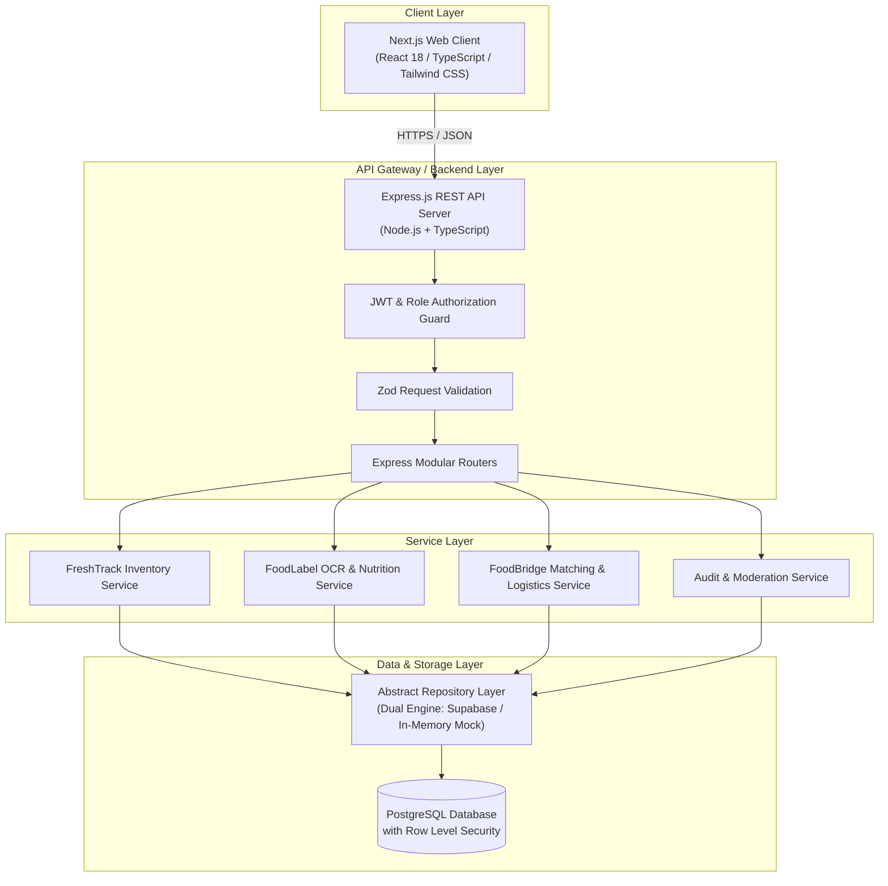
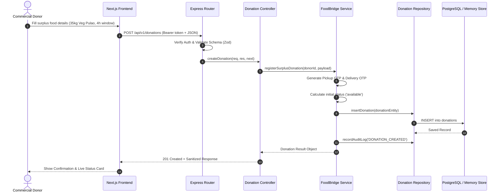
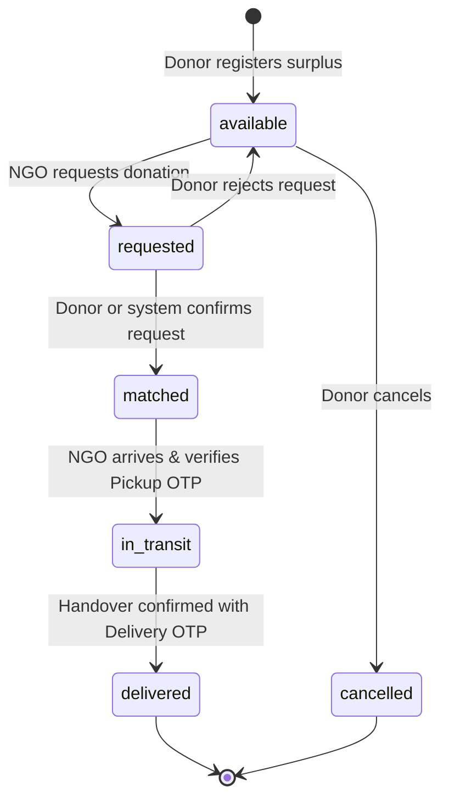

# FoodLoop AI — Architecture Documentation

This document describes the architectural principles, system topology, component interactions, and data flows of the **FoodLoop AI** platform.

---

## 1. System Overview

FoodLoop AI is an integrated, modular full-stack web platform designed to combat food waste and food insecurity across three connected dimensions:
1. **FreshTrack**: Household food tracking, intelligent expiration monitoring, and waste prevention analytics.
2. **FoodLabel AI**: Computer vision and NLP-assisted nutrition label analysis, allergen danger alerting, and bilingual (English/Hindi) food literacy.
3. **FoodBridge**: Real-time logistics bridge matching commercial/event food surplus with verified community relief NGOs using weighted multi-criteria algorithms and OTP verification.



---

## 2. Monorepo Structure & Separation of Concerns

FoodLoop AI enforces a strict boundary between frontend presentation and backend business logic:
- `frontend/`: UI rendering, state management, client validation, and authenticated API client invocations. Does not hold database secrets or private encryption keys.
- `backend/`: REST APIs, authentication token validation, rule enforcement, database access, business rules, and audit logging.
- `database/`: Schema migrations, PostgreSQL RLS definitions, performance indexes, and seed files.
- `docs/`: Technical specifications, OpenAPI references, and compliance guidelines.

---

## 3. Backend Layered Architecture

To ensure high testability, maintainability, and domain decoupling, the backend follows an explicit 5-stage pipeline:

```text
HTTP Request
     ↓
[ Routes ]          → Defines endpoint URIs, HTTP methods, and attaches middleware.
     ↓
[ Controllers ]     → Unpacks request payloads, invokes service methods, maps responses/HTTP status codes.
     ↓
[ Services ]        → Core business logic, status state-machine transitions, scoring calculations.
     ↓
[ Repositories ]    → Handles persistence and query logic (PostgreSQL via Supabase or In-Memory).
     ↓
[ Database / Store] → Relational persistence with constraints and RLS.
```

### Data Flow Example: Creating a Surplus Food Donation



---

## 4. FreshTrack: Date Label vs Food Safety Model

FreshTrack enforces a strict semantic distinction between commercial labeling and actual food safety:
- **Best Before (BB)**: Relates to sensory quality (flavor, texture, aroma). Foods past this date are often still edible if storage integrity was preserved.
- **Use By (UB)**: Strict safety deadline for perishable foods (raw poultry, unpasteurized dairy). After this date, consuming risks microbiological pathogens.
- **Expiry Date (EXP)**: Regulatory expiration threshold.

The FreshTrack analytics engine categorizes items into four dynamic freshness zones:
1. `Fresh`: > 3 days remaining.
2. `Expiring Soon`: 1 to 3 days remaining (triggers AI recipe ideas and push notifications).
3. `Critical Today`: Expires in < 24 hours.
4. `Past Date`: Flagged for sensory check (Best Before) or disposal/composting (Use By).

---

## 5. FoodBridge: Rule-Based Matching Algorithm

Matching donations to NGOs is computed deterministically rather than through unvalidated machine learning blackboxes. The matching score $S \in [0, 100]$ is computed as:

$$S = w_{\text{dist}} \cdot S_{\text{dist}} + w_{\text{cap}} \cdot S_{\text{cap}} + w_{\text{diet}} \cdot S_{\text{diet}} + w_{\text{urgency}} \cdot S_{\text{urgency}}$$

Where:
- **Distance Score ($S_{\text{dist}}$)**: Computed using the Haversine great-circle formula between donor coordinates $(\phi_1, \lambda_1)$ and NGO depot $(\phi_2, \lambda_2)$. Drops linearly from 100 at 0km to 0 at 25km.
- **Capacity Score ($S_{\text{cap}}$)**: Compares surplus weight (kg) to the NGO's declared daily capacity.
- **Dietary & Category Fit ($S_{\text{diet}}$)**: Match between donation attributes (`cooked`, `packaged`, `bakery`) and NGO accepted food types.
- **Urgency Bonus ($S_{\text{urgency}}$)**: Boosts priority for highly perishable donations expiring in less than 4 hours.

### Donation State Machine



---

## 6. Security & Authorization Matrix

| Role | FreshTrack | FoodLabel AI | FoodBridge (Donor) | FoodBridge (NGO) | Admin Moderation |
| :--- | :---: | :---: | :---: | :---: | :---: |
| **Household User** | Read / Write Own | Read / Write Own | View Public Listings | Read Public | ❌ |
| **Commercial Donor** | ❌ | Read / Write Own | Create & Manage Surplus | Read Public | ❌ |
| **NGO Organization** | ❌ | Read / Write Own | View Available Listings | Request & Receive Surplus | ❌ |
| **Platform Admin** | Audit View | Audit View | Full Moderation | Full Moderation | Full System Control |

- **OTP Verification**: Both pickup and delivery involve cryptographically randomized 6-digit numeric codes generated on the server and verified exclusively via backend endpoints to eliminate phantom pickups.
- **Data Privacy**: Private donor warehouse addresses and phone numbers are hidden from unauthenticated viewers and only revealed once a donation match is confirmed.
