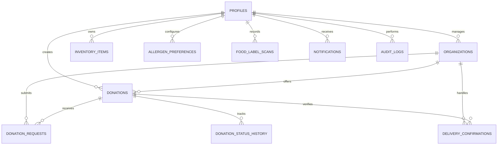

# FoodLoop AI — Database Architecture & Schema Specification

This document provides a comprehensive overview of the PostgreSQL data model underpinning **FoodLoop AI**.

---

## 1. Entity-Relationship Overview

---

## 2. Table Specifications

### `profiles`
Represents all system actors with role-based attributes.
| Column | Type | Constraints | Description |
| :--- | :--- | :--- | :--- |
| `id` | UUID | PRIMARY KEY | Foreign key to `auth.users` in Supabase |
| `email` | VARCHAR(255) | UNIQUE, NOT NULL | Account email address |
| `full_name` | VARCHAR(255) | NOT NULL | Display name |
| `role` | `user_role` | NOT NULL, DEFAULT `'household'` | `'household'`, `'donor'`, `'ngo'`, `'admin'` |
| `avatar_url` | TEXT | NULLABLE | Profile picture URL |
| `phone` | VARCHAR(50) | NULLABLE | Contact telephone |
| `preferred_language` | VARCHAR(10) | DEFAULT `'en'` | Interface localization code |

---

### `organizations`
Registered commercial donors (restaurants, supermarkets, catering) and charitable NGOs.
| Column | Type | Constraints | Description |
| :--- | :--- | :--- | :--- |
| `id` | UUID | PRIMARY KEY | Unique organization ID |
| `user_id` | UUID | REFERENCES profiles(id) | Managing user |
| `name` | VARCHAR(255) | NOT NULL | Official entity name |
| `org_type` | `user_role` | CHECK (`org_type` IN (`donor`, `ngo`)) | Type classification |
| `registration_number` | VARCHAR(100) | NULLABLE | NGO 80G or FSSAI registration ID |
| `address` | TEXT | NOT NULL | Street address |
| `city` | VARCHAR(100) | NOT NULL | City location |
| `latitude` | DECIMAL(10, 7) | NOT NULL | Geographic latitude |
| `longitude` | DECIMAL(10, 7) | NOT NULL | Geographic longitude |
| `verification_status` | `org_verification_status` | DEFAULT `'pending'` | `'pending'`, `'verified'`, `'rejected'` |
| `daily_capacity_kg` | DECIMAL(10, 2) | DEFAULT 100.0 | Food handling capacity |

---

### `inventory_items` (FreshTrack)
Food items stored in household pantries, refrigerators, and freezers.
| Column | Type | Constraints | Description |
| :--- | :--- | :--- | :--- |
| `id` | UUID | PRIMARY KEY | Item unique identifier |
| `user_id` | UUID | REFERENCES profiles(id) | Household item owner |
| `name` | VARCHAR(255) | NOT NULL | Item label |
| `category` | VARCHAR(100) | NOT NULL | Produce, Dairy, Bakery, Pantry, Meat |
| `quantity` | DECIMAL(10, 2) | NOT NULL, DEFAULT 1.0 | Amount in stock |
| `unit` | VARCHAR(50) | NOT NULL | units, kg, grams, liters, cans, loaf |
| `storage` | `storage_location`| NOT NULL, DEFAULT `'fridge'` | `'fridge'`, `'pantry'`, `'freezer'` |
| `purchase_date` | DATE | NOT NULL, DEFAULT CURRENT_DATE | Acquisition date |
| `expiry_date` | DATE | NOT NULL | Critical threshold date |
| `date_label` | `date_label_type` | NOT NULL, DEFAULT `'expiry'` | `'best_before'`, `'use_by'`, `'expiry'` |
| `safety_guidance` | TEXT | NULLABLE | Storage & sensory evaluation tips |
| `status` | `inventory_status`| NOT NULL, DEFAULT `'fresh'` | `'fresh'`, `'expiring_soon'`, `'expired'`, `'consumed'`, `'wasted'` |

---

### `food_label_scans` (FoodLabel AI)
OCR parsed data, extracted nutrition, and bilingual food explanations.
| Column | Type | Constraints | Description |
| :--- | :--- | :--- | :--- |
| `id` | UUID | PRIMARY KEY | Scan ID |
| `user_id` | UUID | REFERENCES profiles(id) | Associated account |
| `product_name` | VARCHAR(255) | NOT NULL | Extracted product title |
| `extracted_text` | TEXT | NOT NULL | Raw OCR text |
| `ingredients` | JSONB | NOT NULL, DEFAULT '[]' | Parsed ingredient array |
| `nutrition_facts` | JSONB | NOT NULL, DEFAULT '{}' | Calories, sugars, sodium, protein |
| `detected_allergens`| TEXT[] | DEFAULT ARRAY[] | Extracted allergen flags |
| `health_score` | INT | CHECK (0-100) | Calculated algorithmic health score |
| `nutri_grade` | CHAR(1) | CHECK ('A', 'B', 'C', 'D', 'E') | European Nutri-Score equivalent |
| `explanation_en` | TEXT | NOT NULL | Plain-English summary |
| `explanation_hi` | TEXT | NOT NULL | Plain-Hindi translation summary |

---

### `donations` (FoodBridge)
Surplus food posted by commercial donors for charitable pickup.
| Column | Type | Constraints | Description |
| :--- | :--- | :--- | :--- |
| `id` | UUID | PRIMARY KEY | Unique donation ID |
| `donor_id` | UUID | REFERENCES profiles(id) | Authoring donor account |
| `title` | VARCHAR(255) | NOT NULL | Surplus description |
| `food_category` | VARCHAR(100) | NOT NULL | cooked, bakery, produce, dairy |
| `quantity_kg` | DECIMAL(10, 2) | NOT NULL | Total mass in kilograms |
| `servings_estimate`| INT | NOT NULL | Estimated individual meals |
| `expiry_time` | TIMESTAMPTZ | NOT NULL | Time after which food is not edible |
| `pickup_address` | TEXT | NOT NULL | Location for collection |
| `status` | `donation_status` | DEFAULT `'available'` | available, matched, in_transit, delivered |
| `pickup_otp` | VARCHAR(6) | NOT NULL | Secret 6-digit OTP for pickup handover |
| `delivery_otp` | VARCHAR(6) | NOT NULL | Secret 6-digit OTP for delivery signoff |
